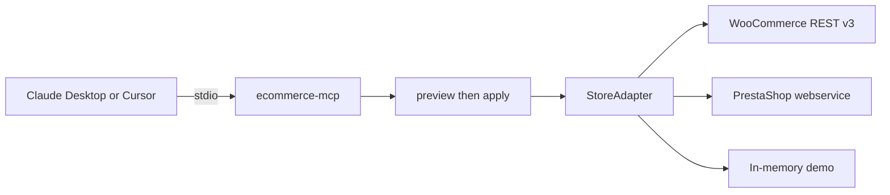

# ecommerce-mcp

An MCP server that lets Claude Desktop or Cursor read a PrestaShop or WooCommerce catalog, and change a price, an SEO field, or a stock level only after you have seen the diff.

Arnaud Merigeau, [arnaud-merigeau.fr](https://arnaud-merigeau.fr). I have spent 18 years on these two platforms. This repo is a clean, generic server you can run against your own shop. It's not affiliated with PrestaShop or WooCommerce.


`docs/demo.gif` is not recorded yet. The capture is `search_products`, then `preview_change`, then `apply_change`.

The process speaks MCP on stdout. Logs go to stderr, and they never include keys.

## Quick start

```bash
pnpm install
pnpm build
node dist/index.js
```

That starts the demo store: three fake products, one fake order, no credentials. Writes stay off. `READ_ONLY` defaults to `true`.

## Architecture



`src/server.ts` registers the tools. `src/changes.ts` keeps a preview in memory for 10 minutes. `src/adapters/StoreAdapter.ts` is the only interface the tools know. `woocommerce.ts`, `prestashop.ts`, and `demo.ts` implement it. `STORE_TYPE` picks one at startup.

Read tools: `search_products`, `get_product`, `get_order`, `list_low_stock`.

Write tools, registered only when the adapter can write and `READ_ONLY` is not true:

1. `preview_change` returns a `changeId` and the exact before/after. It does not write.
2. `apply_change` applies that preview, and refuses if the product changed since, or if the id is older than 10 minutes.
3. After the write, the server reads the product again and returns `verified: true` or `verified: false`.

No order edits, no deletes, no customer export. The demo adapter never writes, even if you set `READ_ONLY=false`.

## Claude Desktop

`claude_desktop_config.json`:

```json
{
  "mcpServers": {
    "ecommerce": {
      "command": "node",
      "args": ["/absolute/path/to/ecommerce-mcp/dist/index.js"],
      "env": {
        "STORE_TYPE": "demo"
      }
    }
  }
}
```

## Cursor

`.cursor/mcp.json`:

```json
{
  "mcpServers": {
    "ecommerce": {
      "command": "node",
      "args": ["/absolute/path/to/ecommerce-mcp/dist/index.js"],
      "env": {
        "STORE_TYPE": "demo",
        "READ_ONLY": "true"
      }
    }
  }
}
```

For a real shop, set `STORE_TYPE` and the keys below. Leave `READ_ONLY=true` until a preview looks right, then set it to `false` and restart the server.

## Environment

Copy `.env.example`. Placeholders only. The URL is the shop root: no `/wp-json`, no `/api`, and no key in the query string. Basic auth is sent as a header.

| Variable                      | Required                      | What it does                                                |
| ----------------------------- | ----------------------------- | ----------------------------------------------------------- |
| `STORE_TYPE`                  | no, default `demo`            | `demo`, `woocommerce`, or `prestashop`                      |
| `READ_ONLY`                   | no, default `true`            | `true` does not register `preview_change` or `apply_change` |
| `WOOCOMMERCE_URL`             | when `STORE_TYPE=woocommerce` | Shop root, `http` or `https`                                |
| `WOOCOMMERCE_CONSUMER_KEY`    | same                          | WooCommerce REST consumer key                               |
| `WOOCOMMERCE_CONSUMER_SECRET` | same                          | WooCommerce REST consumer secret                            |
| `PRESTASHOP_URL`              | when `STORE_TYPE=prestashop`  | Shop root                                                   |
| `PRESTASHOP_API_KEY`          | same                          | Webservice key                                              |

A URL with a username, a password, or `ws_key` / `consumer_key` / `consumer_secret` in the query is rejected. The error does not repeat the value.

## Design decisions

**Preview, then apply, then a fresh read.** A model that can PUT a price will eventually do it on the wrong id. `preview_change` shows the diff and stops there. `apply_change` re-reads the product and refuses when the edited fields, or `updatedAt`, no longer match the preview. The follow-up read is the part a HTTP 200 cannot give you: `verified` is true only when the shop now holds the value you asked for. If the write is accepted but the next read disagrees, you get `verified: false` and the product as it actually is.

**One adapter interface.** WooCommerce keeps SEO in `meta_data`. PrestaShop keeps it in language arrays, and stock lives on `stock_availables`, not on the product. The tools should not know that. A third platform is a new file, not a rewrite of the server.

**Zod at the boundary.** Environment variables, tool arguments, and the objects we return are parsed with the same schemas the handler is typed from. The MCP SDK turns those schemas into the JSON Schema advertised to the client, and checks `structuredContent` before it leaves the process.

## Limits

PrestaShop search and the low-stock scan look at the first 50 rows. WooCommerce low stock looks at the first 100 published products. PrestaShop SEO writes the first language only, and product prices use the first active currency. A WooCommerce price update sets `regular_price` and clears `sale_price`. WooCommerce SEO is written to the meta keys `seo_title` and `seo_description`. If those are empty, Yoast and Rank Math values are read, and those plugin keys are left alone.

## Scripts

`pnpm test` covers both adapters with mocked HTTP, plus the preview flow (including a stale preview, an expired id, and read-only mode). `pnpm dev` runs the TypeScript entry directly. `pnpm lint`, `pnpm typecheck`, and `pnpm build` match CI.

## Roadmap

A Shopify adapter behind the same interface. An HTTP transport for a remote host; stdio stays the default. More than one store in a single process, each with its own preview book.

## License

MIT. See [LICENSE](LICENSE).
